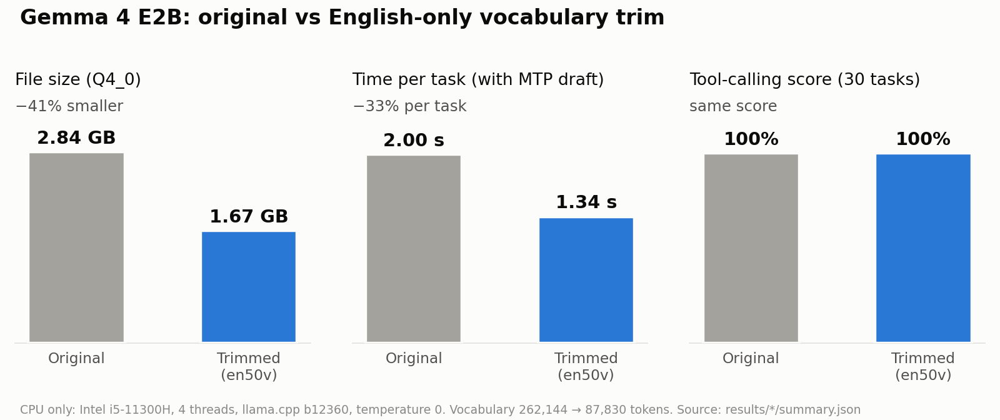
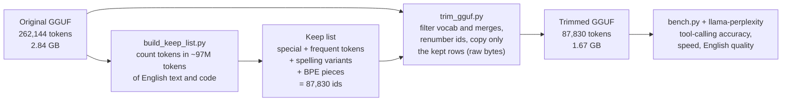

# llm-vocab-trimmer

**Make a multilingual small LLM English-only, without any training, by cutting its vocabulary directly inside the quantized GGUF file.**

I applied it to Google's **Gemma 4 E2B** (4-bit, llama.cpp) for an on-device assistant. The trimmed model is **41% smaller and 33% faster per task**, and it scores the same **100%** on my tool-calling benchmark. English perplexity shows no measurable change.

| | Original Gemma 4 E2B | Trimmed (en50v) | Change |
|---|---|---|---|
| Vocabulary | 262,144 tokens | 87,830 tokens | −66% |
| File size (Q4_0) | 2.84 GB | **1.67 GB** | **−41%** |
| Peak RAM | 3.02 GB | 2.53 GB | −16% |
| Time per task (with MTP draft) | 2.00 s | **1.34 s** | **−33%** |
| Generation speed | 14.5 tok/s | 21.5 tok/s | +48% |
| Tool-calling accuracy (30 tasks) | 100% | **100%** | same |
| English perplexity (WikiText-103 test) | 48.1 ± 1.9 | 45.7 ± 1.8 | within error |

CPU only: Intel i5-11300H, 4 threads, llama.cpp b12360, temperature 0.



**Trimmed model:** [Nilmon/gemma-4-E2B-en50v-GGUF](https://huggingface.co/Nilmon/gemma-4-E2B-en50v-GGUF) on Hugging Face.

---

## Why this works

In small multilingual models, a large share of the weights is per-token tables: the embedding rows and the output layer. Gemma 4 E2B also has extra *per-layer* token embeddings. I read the GGUF file and measured it:

| Part of Gemma 4 E2B | Params | On disk | Share |
|---|---|---|---|
| `per_layer_token_embd` (per-layer token tables) | 2.35B | 1.32 GB | 50.7% |
| transformer blocks (the "brain") | 1.86B | 1.05 GB | 40.3% |
| `token_embd` (also the output layer) | 0.40B | 0.43 GB | 8.7% |

About 59% of the file is rows for tokens, and most of those tokens are other languages. An English-only assistant never uses those rows, so removing them costs nothing, and the output layer gets about 3× smaller, which speeds up every generated token.

## How it works



A GGUF model stores one row of numbers per token in its token tables. Keeping a token means keeping its row; dropping a token deletes its row. Nothing is retrained and nothing inside the transformer blocks changes.

1. **Pick the tokens to keep** (`scripts/build_keep_list.py`)
   - Tokenize about 97M tokens of English with the real tokenizer: WikiText-103 (61M), UltraChat English conversations (27M), Python standard-library source (10M), plus the benchmark prompts.
   - Keep every special, control and byte-fallback token, whitespace runs (for code indentation), printable ASCII, and common symbols and emoji.
   - Keep every token used at least **N** times (N = 50 here).
   - Keep **spelling variants** of every kept word: with and without the leading-space marker `▁`, in lower, Capital and UPPER case.
   - **BPE closure:** replay the merges for each kept token and keep every intermediate piece, so the trimmed tokenizer can still build every kept token.

2. **Write a new GGUF** (`scripts/trim_gguf.py`)
   - Filter the token list, scores and types, renumber the ids, keep only the BPE merges whose parts survive, and remap the special-token ids.
   - Slice every tensor whose row dimension is the vocab size, row by row on the **raw quantized bytes**. There is no de-quantization or re-quantization, so the kept rows are bit-identical.
   - The same keep list trims Gemma 4's MTP draft model, so speculative decoding still works.

English and code text tokenize **identically** before and after the trim. Non-English text still works through byte fallback, but it takes more tokens and quality drops. For example, a Hindi sentence goes from 12 to 29 tokens.

## Lesson learned: spelling variants matter

My first version kept tokens by corpus frequency only. On the benchmark, accuracy fell to **83–93%**, and the model wrote things like `"whatssapp"` and `"bluetoot"`.

The cause: the corpus mostly contains `▁WhatsApp` (leading space, capital letter), so `whatsapp` with no space was dropped. Inside JSON the model writes `"name": "whatsapp"` with no leading space, so it had to spell the word from smaller pieces and made typos.

Keeping the case and space variants of every kept word added about 26k tokens and brought accuracy back to **100%**.

| Variant | Vocab | Right tool | Fully right | s/task (MTP) | File |
|---|---|---|---|---|---|
| Original | 262,144 | 100% | 100% | 2.00 | 2.84 GB |
| **en50v** (N=50 + variants) | 87,830 | 100% | **100%** | **1.34** | **1.67 GB** |
| en20v (N=20 + variants) | 100,826 | 100% | 100% | 1.43 | 1.76 GB |
| en20 (no variants) | 79,510 | 97% | 93% | 1.45 | 1.61 GB |
| en50 (no variants) | 61,697 | 97% | 83% | 1.38 | 1.49 GB |

RAM drops less than file size. llama.cpp memory-maps the file and only touches the rows of tokens that are actually used, so the unused rows were never fully in RAM to begin with. The real wins are disk size and speed.

## Benchmark

`bench/tasks.json` has 30 assistant requests, such as opening apps, web search, reminders, messages, music, settings, notes, small talk, and hard questions that should go to a bigger model. Each request must come back as `{"tool", "args"}` JSON, enforced by a JSON-schema grammar. A task counts as fully right when the tool is correct and every argument contains an expected keyword.

Before trimming, I compared 8 small models with the same benchmark (`results/baseline/`):

| Model | Fully right | s/task | Peak RAM | File |
|---|---|---|---|---|
| Gemma 4 E2B + MTP | 100% | 2.00 | 3.02 GB | 2.84 GB |
| Gemma 4 E2B | 100% | 3.80 | 2.81 GB | 2.84 GB |
| Qwen 3.5 2B | 93% | 2.07 | 2.09 GB | 1.28 GB |
| Llama 3.2 3B | 87% | 2.91 | 4.02 GB | 2.02 GB |
| LFM 2.5 1.2B | 63% | 2.74 | 1.38 GB | 0.73 GB |
| Qwen 2.5 0.5B | 50% | 1.09 | 0.58 GB | 0.49 GB |
| Qwen 3.5 0.8B | 50% | 1.31 | 0.98 GB | 0.53 GB |
| Gemma 3 1B | 40% | 3.79 | 1.04 GB | 0.81 GB |

Gemma 4 E2B was the most accurate but too big for a 4 GB phone, and more than half of its file was token tables. That made it the ideal candidate for trimming.

## Reproduce

```bash
pip install -r requirements.txt
python scripts/download_data.py                       # ~3.1 GB into ./data

# 1. keep list (writes keep_lists/keep_ids_50v.json)
python scripts/build_keep_list.py --gguf data/mtp-gemma-4-E2B-it-Q4_0.gguf --data data 50

# 2. trim the model and its MTP draft with the same list (--verify re-reads the output and
#    checks every kept row is bit-identical to the original)
python scripts/trim_gguf.py data/gemma-4-E2B-it-Q4_0.gguf     out/gemma-4-E2B-en50v-Q4_0.gguf     keep_lists/keep_ids_50v.json --verify
python scripts/trim_gguf.py data/mtp-gemma-4-E2B-it-Q4_0.gguf out/mtp-gemma-4-E2B-en50v-Q4_0.gguf keep_lists/keep_ids_50v.json --verify

# 3. benchmark (needs a llama.cpp build with llama-server)
python scripts/bench.py --server path/to/llama-server --model out/gemma-4-E2B-en50v-Q4_0.gguf --draft out/mtp-gemma-4-E2B-en50v-Q4_0.gguf

# 4. English perplexity
llama-perplexity -m out/gemma-4-E2B-en50v-Q4_0.gguf -f data/wiki_test.txt -c 512 --chunks 40
```

Other useful commands:

```bash
# where the bytes are: per-token tables vs transformer blocks (read-only, works on any GGUF)
python scripts/inspect_gguf.py data/gemma-4-E2B-it-Q4_0.gguf out/gemma-4-E2B-en50v-Q4_0.gguf

# unit tests: tiny synthetic GGUF files, no model download, about a second
pip install pytest
python -m pytest tests
```

`trim_gguf.py` refuses to overwrite an existing output (add `--force`), checks that the keep list is sorted, unique and in range for the model, and writes the kept rows in chunks of 4,096 rows instead of building the trimmed tables in memory first (the earlier version held all of them, about 0.6 GB for Gemma 4 E2B, in RAM at once).

`download_data.py` also writes `data/wiki_test.txt`, the WikiText-103 test split as plain text. The keep lists I used are in `keep_lists/`. Building them again from the same data gives identical lists, and trimming with them gives a bit-identical model file (same SHA-256 as the Hugging Face upload).

The Python standard-library part of the corpus comes from the Python that runs step 1, so another Python version can change the list slightly. `keep_ids_50v.json` was rebuilt from scratch on Python 3.13.2 and came out identical.

Step 1 reads the vocabulary from the MTP draft file because that is what I used. Its tokens and merges are the same as the main model's. The only difference is that the main file marks `<|video|>` as a control token, so `--gguf data/gemma-4-E2B-it-Q4_0.gguf` gives the same list plus that one token. Either list works.

## Limits

- English (and code) only. Other languages still work through byte fallback, but slower and worse.
- Tested on Gemma 4 E2B. The trimmer is generic GGUF code and should work for other BPE models whose per-token tensors have the vocab as their row dimension, but I haven't tested others.
- The benchmark is small (30 tasks) and focused on tool calling. It is not a general quality benchmark.
- File size and speed are the gains. Reasoning ability is unchanged, because the transformer blocks are not touched.

## Credits and licenses

- Code in this repo: MIT, see [LICENSE](LICENSE).
- Base model: [Gemma 4 E2B](https://huggingface.co/google/gemma-4-E2B-it) by Google (Apache-2.0). GGUF and MTP draft from [ggml-org/gemma-4-E2B-it-GGUF](https://huggingface.co/ggml-org/gemma-4-E2B-it-GGUF).
- Uses [llama.cpp](https://github.com/ggml-org/llama.cpp) and its `gguf` Python package.
- Data: [WikiText-103](https://huggingface.co/datasets/Salesforce/wikitext) (CC BY-SA), [UltraChat 200k](https://huggingface.co/datasets/HuggingFaceH4/ultrachat_200k) (MIT). Only used to count tokens; none of it is included here.
